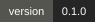
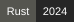
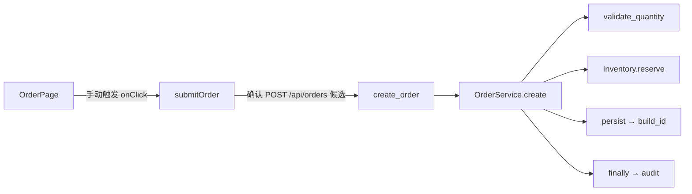
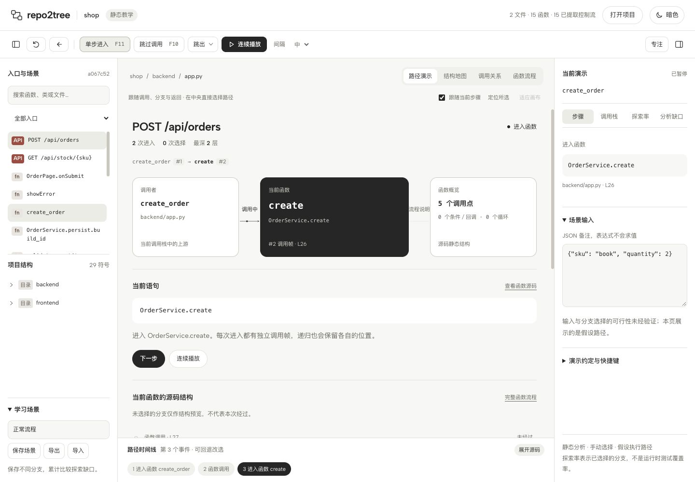
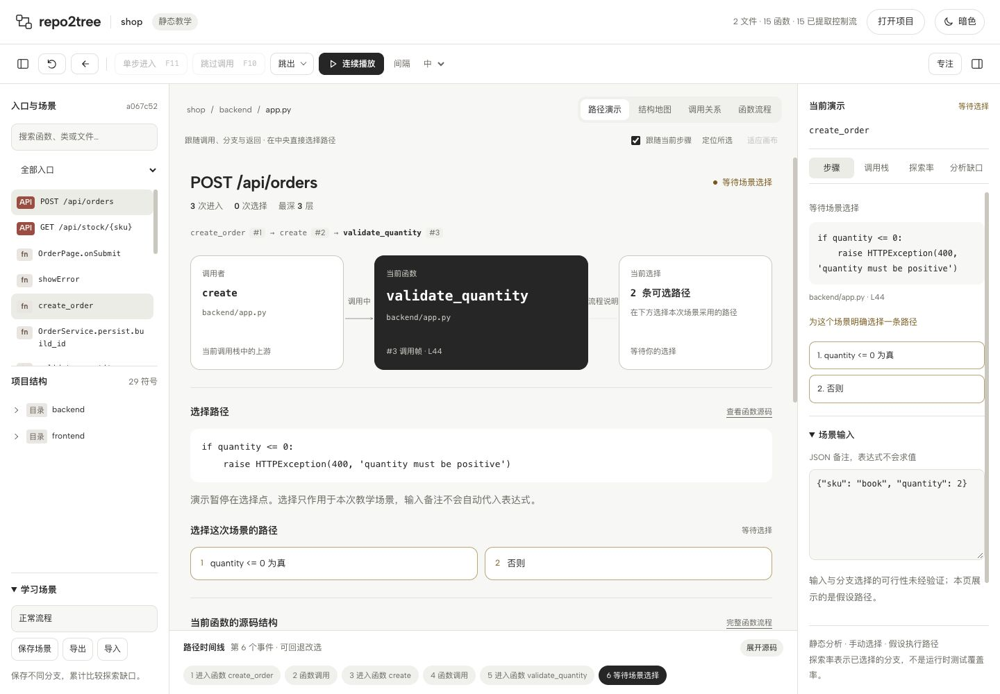
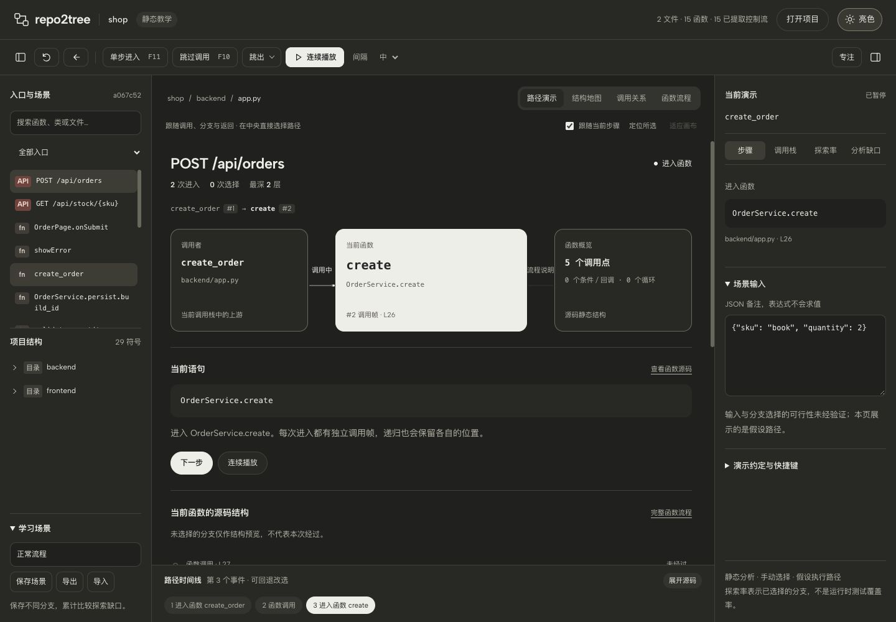

# repo2tree





扫描本地项目，把目录、模块、类和每个函数变成可以逐层进入的代码地图。从 API、前端组件或任意函数出发，手动选择分支，像调试器一样单步演示代码流向。

本版为 **Rust 本地服务 + 静态教学播放器**。不导入、不执行目标项目。输入 JSON 是场景资料，条件由用户选择，表达式不会求值。

## 演示

### 三分钟体验：从前端下单到后端返回

启动后点击「示例项目」，选择 `OrderPage`。每次推进先看当前语句和动作说明，遇到选择点再决定本次路径。以下是成功路径的主要调用关系（省略辅助调用）：



| 阶段 | 你做什么 | 演示重点 |
| --- | --- | --- |
| 选入口 | 选择 `OrderPage`，进入第一步 | 组件入口与函数源码对应 |
| 触发事件 | 选择触发 `onClick`，确认异步主体和 API 候选 | 事件注册、回调执行与跨端调用分别讲解 |
| 选择正常路径 | 数量错误条件不成立、SKU 存在、库存充足；循环进入一次后退出 | 分支由讲解者明确选择，输入备注不自动求值 |
| 跟进调用 | 跟随 `persist` 进入嵌套函数 `build_id` | 调用帧、返回与 `finally` 清理过程 |
| 比较和复盘 | 查看结束复盘，点击选择记录回退改选 | 改选后重建后续路径，保存不同教学场景 |

也可以直接导入已完成的演示场景，查看复盘，再从时间线回到任意步骤：

- [前端下单：成功路径](examples/scenarios/order-success.json)：94 个事件，13 次函数进入，包含回调、API 候选、嵌套函数和清理流程。
- [API 下单：数量无效](examples/scenarios/invalid-quantity.json)：14 个事件，展示校验异常；回到 `quantity <= 0` 选择点改选，可继续探索成功路径。

先点击「示例项目」，再在左下角「学习场景」中点击「导入」选择上述 JSON。不要使用顶部的「导入项目快照」：那里接收的是项目分析数据。场景绑定仓库自带的示例快照，重新扫描得到其他快照后应重新录制场景。这些记录来自静态播放器，未运行示例业务。

### 界面预览

从 API 进入服务方法，查看调用者、当前函数、下一目标和源码结构。右上角切换亮色／暗色，主题与面板布局保存在本地浏览器。



在条件处手动选择路径，播放器会暂停等待确认；可回退改选，也可设置断点逐步讲解。



<details>
<summary>查看暗色工作区</summary>



</details>

截图记录 2026-10-15 的基础界面；当前版本已将步骤动作前置，并增加入口选择与结束复盘。截图使用仓库自带 `examples/shop` 的静态分析数据；它们展示手动教学路径，没有运行示例业务。截图来源与复现步骤见 [截图说明](docs/images/README.md)。

## 启动

需要 Rust、Python 3.10+、Node.js 和 [CodeGraph CLI](https://github.com/colbymchenry/codegraph)。CodeGraph 在本机已安装；本仓库已验证的版本是 1.6.0。

```sh
npm ci
cargo run --release -- serve
```

打开 [本地工作区](http://127.0.0.1:7331)。默认加载随项目提供的下单示例，包含真实静态扫描得到的 15 个函数，可从 `OrderPage` 一路进入 API、`OrderService`、`Inventory` 和嵌套的 `build_id`。

在“打开项目”输入目录。已有索引时直接读取；需要建立或更新索引时勾选“建立／同步 CodeGraph 索引”。也可以从命令行启动：

```sh
# 建立或同步索引，然后生成项目快照
cargo run -- scan --project /absolute/path/to/project --index

# 打开指定项目（读取已有索引）
cargo run -- serve --project /absolute/path/to/project

# 生成可导入的 JSON 快照
cargo run -- scan --project /absolute/path/to/project --out project.json
```

扫描时会显示读取索引、读取源码、解析语言及关联调用等阶段；可随时取消。取消会停止本次解析子进程，保留当前已打开的项目，随后可重试；刷新页面会重新连接正在进行的扫描。开发调试可省略 `--release`，较大项目建议使用优化构建。

网页内可以导入项目快照，保存、导出和导入场景 JSON。场景绑定源码快照；源码变化后不会把旧选择套到新行号上。

## 怎么用

打开项目后先选入口，播放器不会自动开始。“路径演示”优先展示当前语句、它的含义和下一步动作，下方展示调用者、当前函数与待进入目标。源码结构参考与调用记录默认折叠，可按需展开；“本帧经过”只对应当前调用实例，递归不会混用记录。右上角可切换亮色／暗色；点击“查看源码”或“展开源码”可打开代码面板。结构地图、调用关系和完整函数流程仍可切换。

源码、当前语句和函数流程支持语法高亮；调用、分支、返回与异常使用局部暖色标记，整体界面保持黑白。高亮在本机完成，无需外部服务。超大或压缩文件使用纯文本保留完整源码；行号和断点继续可用。

1. 从中央入口列表或左侧搜索选择 HTTP API、前端组件或任意函数。
2. 在结构地图双击目录／模块／类进入，面包屑返回；选择函数查看源码，双击函数查看内部流程。调用关系视图显示所有已索引或推断的邻居。
3. 单步进入、跳过调用、跳出函数／类／模块。遇到条件、回调、候选调用目标、循环或异常处理器时明确选择本次假设。
4. 点击“设置函数断点”或源码行号。跳过和跳出也会命中内部断点。连续播放在选择点和断点暂停。
5. 后退或点击时间线回到选择点，改走另一条路；命名并保存各场景，在“探索率”查看累计分支缺口。

F11 单步、F10 跳过、Shift+F11 跳出、F8 播放／暂停、Esc 暂停、`[` / `]` 折叠两侧、F 专注。源码高度可拖动，折叠布局会保存。小屏用两侧竖条切换面板。

### 一次清楚的讲解

先选定要解释的入口和输入假设，再跟随“查看函数第一步”“跟进此调用”“选择调用目标”等具体动作推进。每到条件、循环或候选调用处暂停，说明为什么选择这条路径。中途想比较另一种情况，点击“本次选择”中的记录，直接回到原选择点；改选会替换旧路径的后续事件。跳过或跳出途中遇到选择时会说明选择后继续哪项操作，断点仍优先。

路径结束后显示复盘：函数进入次数、选择次数和调用深度。可以保存本次场景、回到最近的选择点，或从同一入口重新演示。场景备注只保存教学假设，不会自动代入代码。

## 分析与演示的边界

| 能力 | 当前状态 |
| --- | --- |
| CodeGraph 全量符号和关系 | 保留所有已索引符号与边；结构地图显示目录／模块／类型／函数，字段等附属符号保留在快照 |
| Python 控制流 | 函数、方法、lambda、嵌套函数、条件与短路、循环、match、异常、finally、返回、break/continue |
| TS/JS/TSX/JSX 控制流 | 函数、方法、箭头回调、JSX 事件、条件／短路、switch fallthrough、循环、try/finally、await 边界 |
| 其他语言 | 浏览 CodeGraph 结构和调用关系；函数内控制流标为“未适配”，需要明确假设才能继续 |
| API 连接 | FastAPI/Flask 风格装饰器和同文件 router 前缀、Express 风格命名 handler；按 HTTP 方法和路径生成**候选**，由用户确认 |
| 循环／递归 | 每轮手动选择继续或退出；递归保留独立调用帧，达到边界询问，不默默截断成一轮 |
| 输入、覆盖 | 记录输入备注和每个假设；统计候选可达范围内的分支探索率，不能证明输入可行性或测试覆盖率 |
| 源码变化 | 文件哈希校验；索引过期的关系降级为候选并提示同步 |

动态注入、反射、跨服务代理、跨文件多级 router mount、隐式协议与运行时多态可能无法静态确定。未知调用保留为边界。Python `with` 的隐式协议、`except*` 异常组、JS 带标签的跳转会明确提示模型缺口。异步和生成器进入主体需要教学假设，不模拟真实调度或并行时序。装饰器执行、隐式框架生命周期及所有语言的完整语义尚未实现。

“包含每个函数”以索引和适配器能够识别的源码实体为范围；宏展开、生成代码、索引忽略的文件以及运行时创建的函数不应被宣称为完整。源码只读取项目根内文件；超出根目录的符号保留但不读取对应文件。

## 可选 LSP

支持直接与 stdio LSP 交互：initialize → didOpen → prepareCallHierarchy → outgoingCalls。没有调用层级能力、请求失败或目标不在本地符号表中时，不会伪造关系。LSP 只补充静态语义，不能决定分支条件。

```sh
cargo run -- scan --project /path/to/rust-project \
  --lsp-command rust-analyzer --lsp-language rust --out project.json

# 参数独立传入，不会经过 shell
cargo run -- scan --project /path/to/web-project \
  --lsp-command typescript-language-server --lsp-arg=--stdio \
  --lsp-language tsx --out project.json
```

语言服务器需自行安装。LSP 协议路径有本地模拟服务器测试；不同真实服务器的工作区预热、版本与配置仍需逐一验收。界面扫描目前使用 CodeGraph + AST，可导入带 LSP 结果的 CLI 快照。

## 验证

```sh
npm test
cargo test
python3 tests/scan_http.py target/debug/repo2tree

# 启动服务后：Chrome 独立临时用户目录，不使用日常浏览器配置
node tests/browser_integration.mjs http://127.0.0.1:7331

# 重建示例快照
cargo run -- scan --project examples/shop --index --out examples/demo.project.json
```

测试分别检查控制流语义、扫描完整性／不执行源码、LSP 协议、前后端演示路径与浏览器交互。详细结果见 [验收记录](docs/verification.md)。

## 设计和代码入口

- [调研与取舍](docs/research.md)：Tavily 检索的同类项目及借鉴范围。
- [架构与控制流模型](docs/architecture.md)：数据、语义、模块职责及扩展方向。
- `src/`：Rust CLI、本机 HTTP 服务、只读 CodeGraph 导入、可选 LSP。
- `adapters/`：只解析源码的 Python／TypeScript 适配器。
- `web/engine.js`：独立可测试的确定性播放器；`web/presentation.js` 统一步骤说明、下一步动作与按调用帧隔离的展示状态；`web/app.js` 组织界面，`style.css` 实现参考 OpenDesign 的中性色明暗主题、分组控件与自适应演示布局。
- `examples/shop/`：示例源码；`examples/demo.project.json`：可重复生成的静态快照。

此前的 `SKILL.md`、`scripts/`、`assets/` 和旧测试保留为早期原型，新的应用从 `cargo run -- serve` 启动。全局 `~/.agents/skills/code-flow-debugger` 没有改动。

### 更新语法高亮资源

高亮模块已随仓库提供。修改语言列表或升级 highlight.js 后，运行 `npm run build:syntax`，再重新构建 Rust 服务。来源、许可及打包说明见 [web/vendor/README.md](web/vendor/README.md)。语法着色支持的语言与结构化控制流适配范围相互独立。
