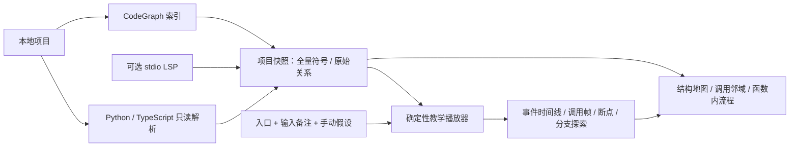

# repo2tree：完整结构索引与静态教学播放器

## 产品模型

用户确认：不运行项目，手动选择分支；直接重构独立应用。Python + TypeScript/React 是本轮建议并采用的第一批控制流适配语言；Rust 实现本地核心。

这里的“执行”只指播放器推进模型，不是项目实际运行。静态关系、模型步骤、场景中的调用实例是三个独立对象。

## 数据职责与不变量

| 对象 | 关键字段 | 不变量 |
| --- | --- | --- |
| 项目快照 | schemaVersion、snapshot.id、project、nodes、edges、flows、sources、diagnostics | 快照 ID 由分析内容生成；场景必须精确匹配；不使用时间戳冒充版本 |
| Symbol | id、kind、name、qualifiedName、path、line、column、parent、origin、flowStatus | CodeGraph 的每个符号保留；AST 可补缺；嵌套函数保持词法归属 |
| 静态关系 | source、target、kind、line、column、origin、status | 调用边不自带执行次序；一行多个调用不得按任意次序挪用目标 |
| Flow operation | id、kind、line、text、targets、arms、body、elseBody、finallyBody | 调用、条件、循环和返回来自语法结构；没有提取出的流程不得由关系图编造 |
| Call target | id、origin、status | CodeGraph / LSP 索引结果与 name-candidate / http-route-match 可区分；候选进入前要选择 |
| Invocation | symbol、invocation | 同一函数的递归或重复调用共享 Symbol，但每次调用帧不同 |
| Scenario | mode=hypothetical、snapshot、entry、inputs、responses、cursor | 输入不求值；选择记录可回放；回退改选会切掉旧路径的后续事件 |
| Coverage | symbol + op + choiceKind → 已选出口集合 | 只统计已探索假设；不等于真实运行、可达性证明或路径穷尽 |

行列范围沿用解析器／索引的约定；LSP 请求单独换算为从零开始的行与 UTF-16 字符位置。当前 op ID 在同一快照内稳定；跨快照断点迁移不猜测。

## 扫描与解析

1. 目录规范化。只有显式 `--index` 或界面勾选才启动 CodeGraph init/sync。
2. 以只读 SQLite 事务读取 nodes、edges、unresolved_refs、files 和版本信息。不会迁移 CodeGraph 数据库。
3. 读取项目根以内的源码并核对 SHA-256。源码变化时，涉及该文件的旧索引调用关系降级为候选并诊断。
4. Python／TS 解析文本，补充匿名函数、箭头函数、lambda 和词法 parent；读取失败仍保留索引符号。
5. 归一化为统一步骤协议，为符号 ID、函数名称和 caller／行号／目标名称建立一次性查找索引；LSP 别名额外核对列号。缺失行号不能互相匹配为调用点。依据同一 caller、调用点和目标名称关联边。没有可靠边时保留同名候选，未知目标保留为边界。
6. 保存项目 JSON；源码、图、流程和诊断与场景播放器解耦。

CodeGraph 中并非每个 kind 都可调用。数据保留字段、变量、类型别名等附属符号，结构图仅投影目录、模块、类型、类和函数。分页、层级聚合和搜索不改变底层索引范围。

### 任务进度与取消

`src/scan_job.rs` 提供线程安全的阶段进度与取消标记，扫描循环逐步检查；解析器输入、输出和错误管道并发排空，防止大项目堵塞。Python／Node 解析限时 120 秒，显式 CodeGraph 建立／同步索引限时 600 秒；取消和超时终止本次专属进程组（Unix），不影响其他项目的 CodeGraph 服务。

`POST /api/scan` 仍返回完整结果；`GET /api/scan/status` 查询阶段、数量、耗时及完成错误，`POST /api/scan/cancel` 请求取消。后台任务独立持有互斥锁，浏览器断开不会放行第二次扫描；只有成功且未取消的扫描会替换已打开的项目。浏览器刷新会重新连接进度并在完成后加载结果。

### API 与前端

前端 JSX 的事件注册与回调触发分别表达。箭头函数有独立身份；不是因为看见 `onClick` 或 `.then` 就在渲染时执行函数。

HTTP 连接需要方法与路径匹配，并生成候选。绝对外部 URL 不会仅凭 path 被接入本项目后端。当前适配器支持的 router mount 范围有限；跨文件多级 mount、代理前缀、GraphQL / RPC 和动态 URL 都需要新增适配，而非猜出一个 handler。

### 可选 LSP

Rust stdio 客户端实现 Content-Length 帧、初始化、didOpen、prepareCallHierarchy、outgoingCalls、服务端配置请求回复、单次请求超时和子进程清理。每个语言服务器需单独指定可执行文件和参数，无 shell 字符串执行。

只有 LSP 目标能够映射到当前本地 Symbol 时才补边。来自外部依赖或无法对齐的目标当前不会被创建为源码实体；原有调用点继续显示未解析边界。真实服务器兼容性不是本版已完成的全面承诺。

## 播放器语义

播放器以 generator 产生离散事件，以结构化 control signal 处理 return、raise、break、continue。

- 条件／switch／回调：暂停等待明确出口；不根据输入字符串执行表达式。
- 循环：每轮询问继续或退出；for 的 iterable 只展开一次，while 条件每轮展开。continue 经 finally 后进入增量步骤；break 不执行 loop-else。
- try：异常进入手动处理器选择；正常完成才进入 else。else 或 handler 再抛出的异常不重新进入同一个 handler。
- finally：在正常结束、返回、异常、break、continue 时执行，新的控制信号可以覆盖待处理信号。
- 异步／生成器：主体展开需要显式教学假设。只表现边界与用户选择的局部次序，不推断任务调度、事件循环、Promise 因果或真实并发时间。
- 未知目标：显示“未展开，假设调用返回”；不能因此将未知内部行为算作已覆盖。
- 未适配流程：明确选择假设返回或模拟异常，绝不照静态邻居顺序执行。

### 调试式导航

| 操作 | 停止条件 |
| --- | --- |
| 单步进入 | 下一个演示事件；条件处等待选择 |
| 跳过调用 | 回到起始深度或遇选择／断点 |
| 跳出函数 | 起始调用实例离开活动帧，而不是仅比较函数名 |
| 跳出类／模块 | 找到当前 scope 的最外连续活动帧，等该实例退出；中途可以进入其他类或模块 |
| 连续播放 | 条件、候选、断点、结束或本轮事件上限 |
| 后退／时间线定位 | 按既有选择重新生成到指定游标，不再次执行目标源码 |

断点优先于跳过／跳出。导航在分支处暂停时保留原实例目标，选择后继续原操作。源码断点按文件和行保存；函数断点按符号 ID 保存；全部绑定快照。

## 交互组织

沿用黑白工作区与局部暖色语义标记，提供亮暗切换。演示按“选择入口 → 当前步骤与动作 → 调用上下文 → 选择记录 → 结束复盘”组织。

- 左侧：全量入口搜索、API／UI／函数筛选、懒展开结构树、命名场景。
- 中间：路径演示、结构树图、单函数调用邻域、函数内步骤四种投影；共用选中符号、独立的浏览范围、独立的播放实例。聚合边标明候选，不暗示聚合等于实际执行。
- 右侧：当前假设选择、带实例编号的调用栈、累计分支探索、解析缺口和断点。
- 底部：可定位时间线与源码；源码高度可调整。两侧、源码与专注布局分别控制。
- 动画：只突出当前经过的方向，移动标记单次到达目标；减少动态效果设置下保留静态高亮。

## 模块边界

| 模块 | 实现文件 | 负责 | 不负责 |
| --- | --- | --- | --- |
| CLI | src/main.rs | scan / serve、显式索引参数、可选 LSP | 解释业务条件 |
| Snapshot importer | src/scan.rs | 只读索引、源文本、归一化、目标候选、快照 | 按边排序模拟执行 |
| LSP bridge | src/lsp.rs | 语义目标及调用范围 | 条件求值或实际调试 |
| Control-flow adapters | adapters/ | 文本语法到嵌套步骤 | import / 执行被分析项目 |
| Player | web/engine.js | 调用实例、控制信号、选择日志、导航、回放 | DOM、网络、运行真实代码 |
| Presentation | web/presentation.js | 按需缓存函数结构、按调用实例标记经过、统一步骤说明与动作、选择点索引 | 改变播放器状态或推断分支可行性 |
| Workspace | web/app.js / style.css | 多种投影、来源提示、场景存储、输入备注 | 替播放器判断控制流 |
| Local host | src/server.rs | 嵌入静态资源、扫描任务、项目快照 | 对外开放任意目录读取服务 |

本机服务只绑定 127.0.0.1，写索引端点要求同源 JSON 请求；其他站点不能借浏览器发起扫描。项目解析子进程与目标项目执行是不同概念。

## 后续扩展，当前未实现

1. 按语言新增 Rust / Go / Java CFG 适配，先设可运行的语义样例再标支持；LSP 函数图不替代 CFG。
2. 为大型仓库实现文件级增量缓存、分页协议、按需源码获取与布局 worker；当前数据快照整体装入浏览器。
3. 建立更细的 import／receiver／type 目标绑定，降低同名候选数量；完善跨文件路由注册与 API 基址。
4. 在有限语言子集中加入约束验证、属性测试或符号执行，输出“可行／不可行／未知”而非伪称全部输入覆盖。
5. 可选导入 AppMap / OpenTelemetry 等真实轨迹，以独立模式展示；当前没有运行时轨迹或 DAP 实时调试能力。

### 演示展示状态（2026-10-17）

`buildPresentation(graph, player)` 是展示逻辑的统一入口，中央区域与步骤面板共用其 `guidance`。图索引按快照缓存，函数内部步骤只在访问时建立；操作 ID 在所属函数内查找。路径历史只读到当前游标，经过标记按调用帧编号隔离，避免重复调用／递归互相污染。选择记录保留原 `choice` 事件位置，改选入口直接回到等待选择处。

`Player.choose(selection)` 验证显式选择，并恢复此前暂停的跳过／跳出命令。浏览器只负责是否恢复连续播放；命中断点、完成或预算上限时不会自动跨过去。首次打开项目保持 idle；结束画面使用复盘状态，不再显示不可执行的“下一步”。
